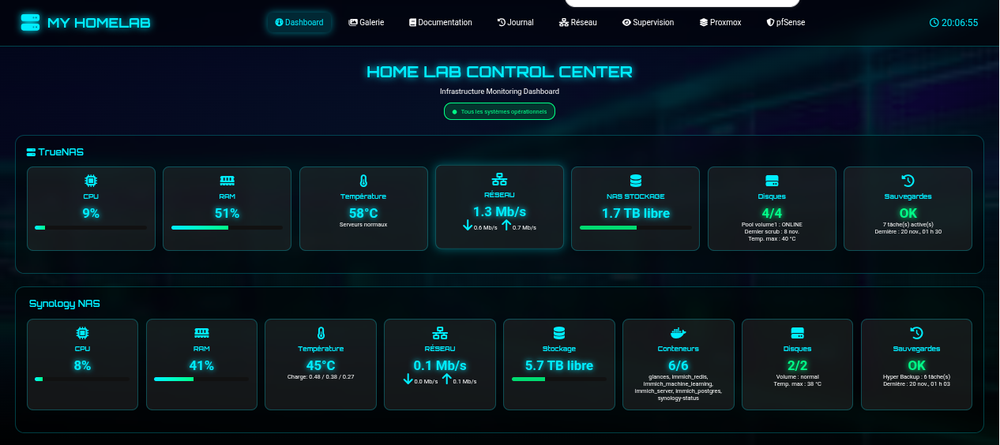
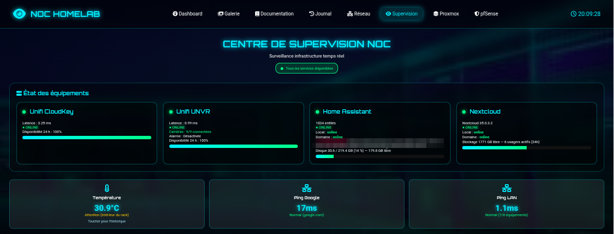
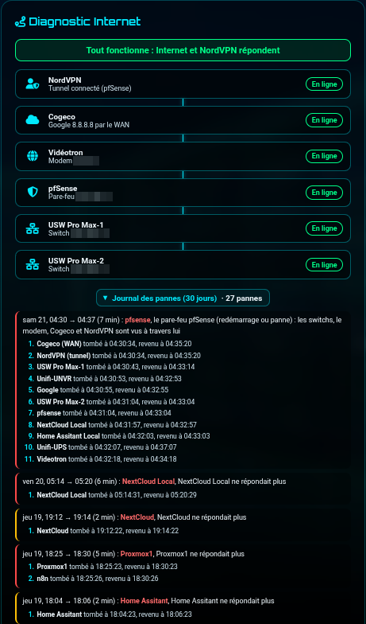
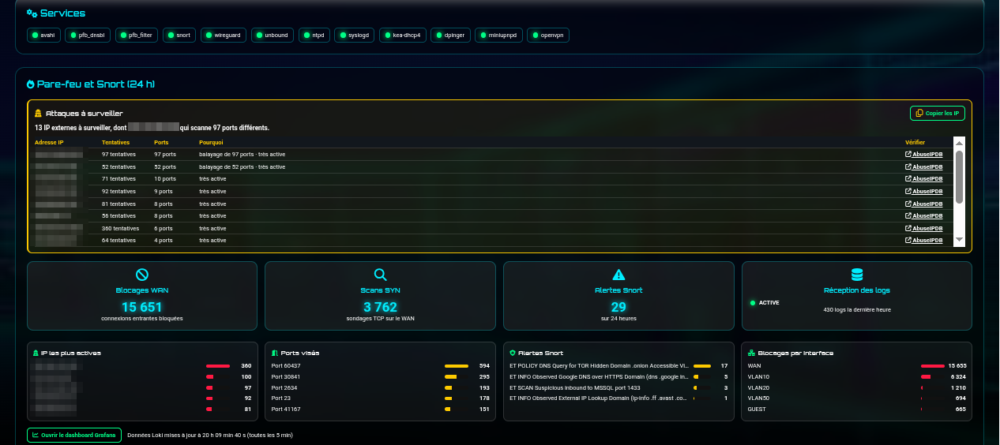

# Homelab Dashboard — Starter Kit


A home-built homelab dashboard plus a **morning report written by a local AI** that
diagnoses problems and proposes fixes you can copy-paste. This kit is the sanitized,
shareable base of my own setup: a dark NOC-style dashboard, an outage log, and the
n8n workflows behind the morning report.

<p align="center">
  
</p>

<p align="center"><b><a href="https://claude.ai/artifact/UrTWWs2ZfZcS3ZK2A4ynHq">Take the full tour →</a></b> &nbsp;·&nbsp; firewall, AI report, GPU, outages, storage and the Android app on one page.</p>

> **It's a recipe, not an installer.** You don't install this — you cook it, with Claude
> as your sous-chef. Bring your own ingredients (your hardware, your firewall, your NAS,
> your network), follow along at your own pace, and season it to taste. The result is
> *your* dashboard, not a copy of mine.

So treat it as a reference and a starting point, not a plug-and-play product. The easiest
way to adapt it is with Claude, step by step — see `2_PROMPT_FOR_CLAUDE.txt`.

> No keys, passwords, real IP addresses or domains are in this repository.
> Addresses shown are examples (`192.168.100.x`), and secrets are marked `A_REMPLIR`
> ("to fill in").

---

## What it does

- **One dashboard for 20+ systems**, sorted into categories (network, storage, hosts,
  security, updates). Fixed rules decide OK / WARN / CRIT — the AI never decides a status.
- **A morning report** built every night by a local model (Ollama). It only receives
  verified facts and a short card per device, then explains each problem and proposes a
  fix in strict JSON.
- **An Internet diagnosis chain**: switches → firewall → modem → ISP → VPN tunnel.
  The lowest failing link is the cause; the ones above are consequences.
- **A 30-day outage log** that records, to the second, the order devices dropped and
  came back — a 3 a.m. outage is still there in the morning.
- **Per-device history**: tap any card on the network map for its timeline over 1, 3, 7
  or 30 days (one bar per hour).

## Screenshots

<p align="center">
  
  <br><sub><b>NOC supervision</b> — every device at a glance. Home Assistant and Nextcloud show two checks: <i>Local</i> (the service itself) and <i>Domain</i> (access from outside, through the Cloudflare tunnel).</sub>
</p>

<p align="center">
  
  <br><sub><b>Internet diagnosis</b> — the chain from the VPN tunnel down to the switches, and the 30-day outage log with the exact order devices dropped and came back. Here, a firewall reboot after an update: the log names the firewall as the cause, not the switches it hides.</sub>
</p>

<p align="center">
  
  <br><sub><b>Firewall &amp; Snort (24 h)</b> — external IPs to watch, checked on AbuseIPDB, plus blocks, SYN scans, Snort alerts and the most targeted ports, read from Loki.</sub>
</p>

<sub>Screenshots come from the original dashboard, which is in French; the pages in this kit are translated to English. External and private IP addresses are blurred. The original may show a few cards that are newer than this kit.</sub>

## What's in the package

```
README.md                      this page
INSTALL_EN.txt                 full installation guide (start here)
1_FILL_IN_FIRST.txt            questions about your setup, to fill in
2_PROMPT_FOR_CLAUDE.txt         instructions to paste into a Claude Project
dashboard/                     the 7 dashboard web pages (HTML/CSS/JS), in English
   README_DASHBOARD.txt            what each page shows, the relays, what to change first
   nginx-example/default.conf      example Nginx config with all the relays (no keys)
n8n/                           the 6 n8n workflows, cleaned
   Verifier_system.json            the morning report (32 nodes)
   Journal_des_pannes.json         outage log, 30 days
   Kuma_Statut_resume.json         Uptime Kuma summary
   Statut_tunnels_et_VPN.json      tunnels and firewall gateways status
   Rapport-matin.json              serves the latest report to the dashboard
   Alertes_temps_reel.json         phone notifications
android/                       optional Android app (WebView) — see android/README.md
```

In the workflows: `A_REMPLIR` = a key/token/password was removed;
`IP_PRIVEE_n`, `PORT_n`, `DOMAINE_n` = an address, port or domain was hidden. The
comments inside the workflows are in French; Claude can translate or explain them.

## Getting started

1. Read **`INSTALL_EN.txt`** — it walks through Docker, Uptime Kuma, the dashboard web
   server (Nginx), Glances, n8n and Ollama, one step at a time.
2. The fastest way to adapt it to your own hardware is with Claude: fill in
   `1_FILL_IN_FIRST.txt`, paste `2_PROMPT_FOR_CLAUDE.txt` into a Claude Project, and go
   one page at a time.

## Android app (optional)

The `android/` folder holds a tiny Android app that opens the dashboard full-screen in a
WebView, so it gets a home-screen icon. It's optional — the dashboard works in any phone
browser. Open the folder in Android Studio, change one line (your dashboard address),
and build your own APK. See `android/README.md`.

## Security

- Keys and passwords live in n8n nodes or in the Nginx config only — never in web pages,
  never in a chat.
- Don't expose n8n, Uptime Kuma, Ollama or the dashboard to the Internet. Use a VPN
  (WireGuard) for remote access.
- Before sharing any n8n export, remove keys, tokens, passwords, addresses and domains.

### Optional — firewall auto-blocklist

The `check_pfsense_logs` node can read the firewall logs and, if you turn it on, add
abusive IPs to a pfSense block list automatically. It's handy but **not required**, and
it ships in "simulation" mode — it only proposes, it writes nothing — until you decide
otherwise. If you'd rather nothing ever touches your firewall, just remove that node and
the rest of the kit keeps working. Firewalls also differ from brand to brand (this kit
uses pfSense), so this is one of the parts you'll adapt to your own gear.

## Credits

Built by **Playback71** for the MY HOMELAB project, with the help of Claude (Anthropic).
November 2026.

Shared so others can build their own. If it helps you, a star is welcome — and feel free
to open an issue with questions.
